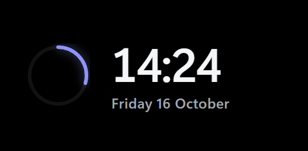
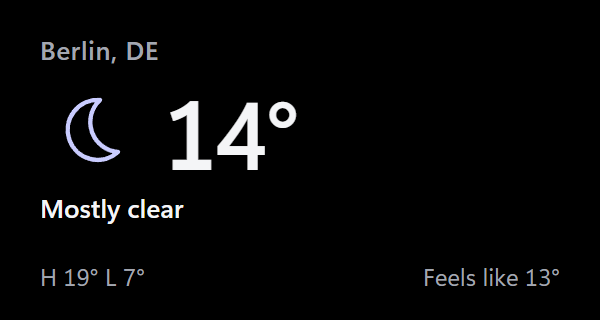
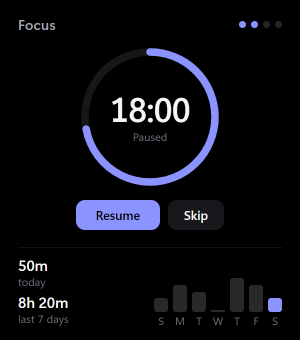
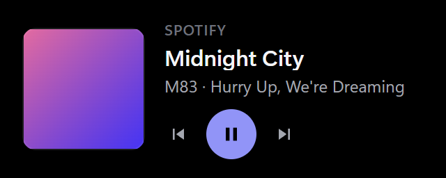
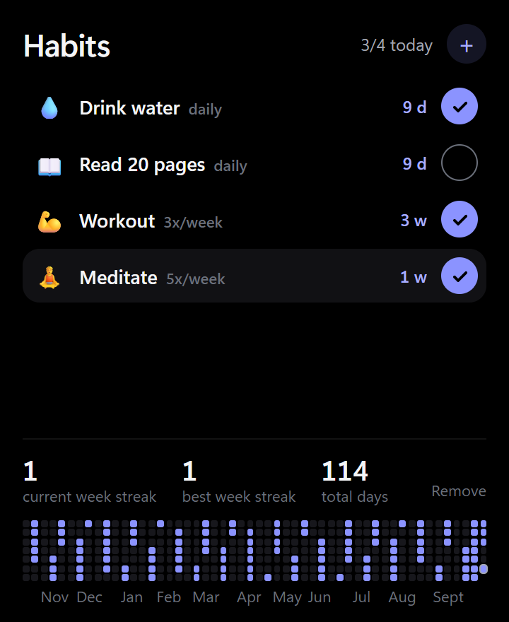
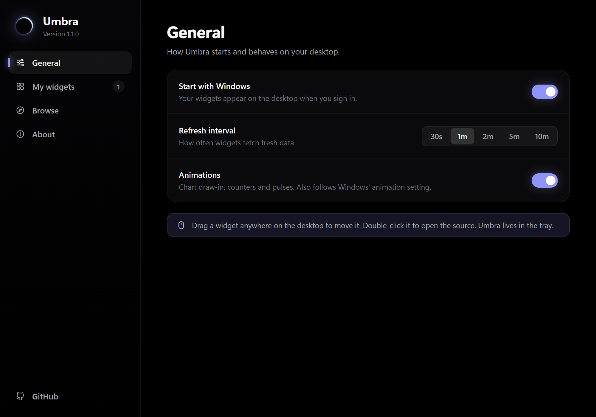
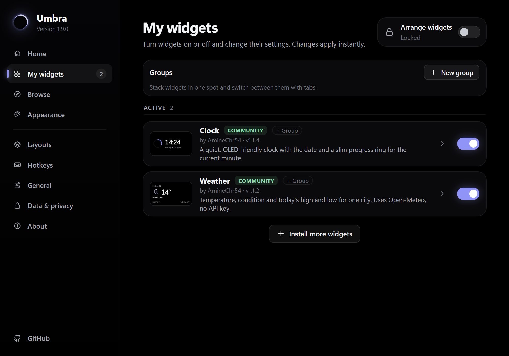
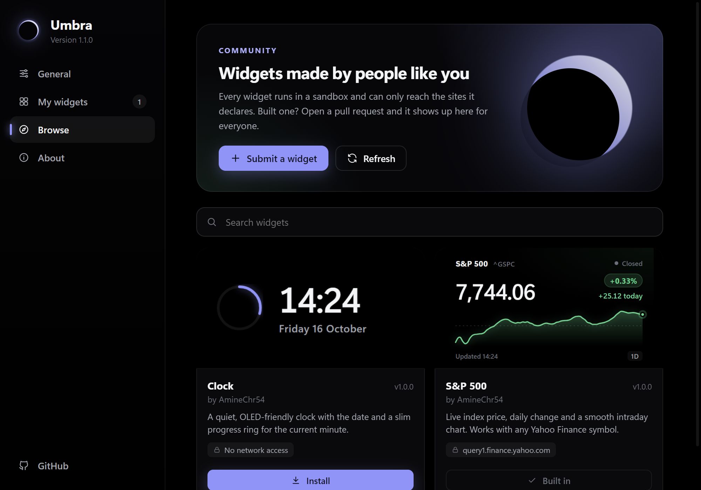
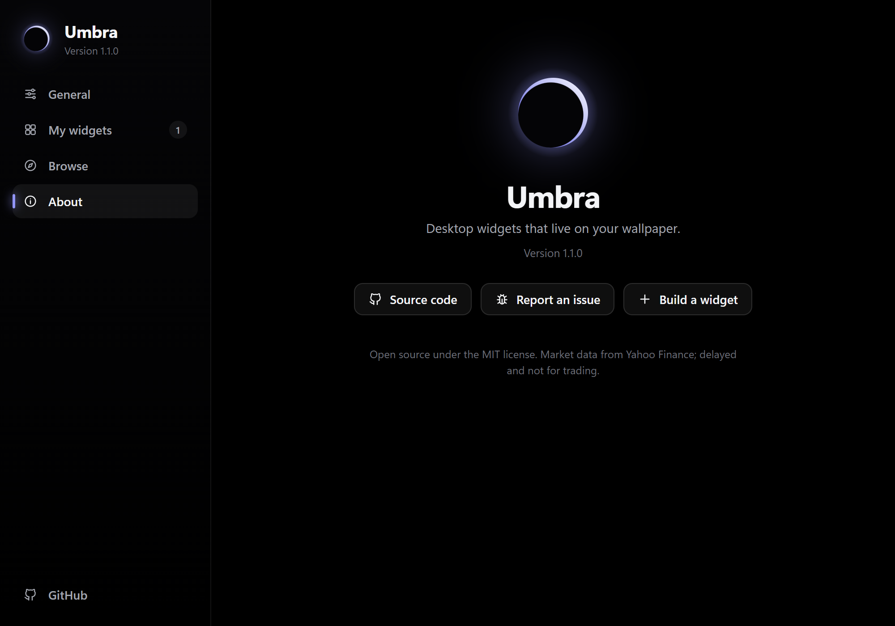

<div align="center">

# Umbra

**Desktop widgets that live on your wallpaper.**

Crisp, true-black widgets pinned under your apps on Windows. Sandboxed, scriptable, and open to anyone who wants to build one.

[](https://github.com/AmineChr54/umbra/releases/latest)
[](https://github.com/AmineChr54/umbra/actions/workflows/ci.yml)
[](https://github.com/AmineChr54/umbra/releases)

[](LICENSE)

**[Download](https://github.com/AmineChr54/umbra/releases/latest)** · [Widget catalog](https://aminechr54.github.io/umbra/) · [Build a widget](CONTRIBUTING.md) · [Automate it](#automate-umbra-cli-scripts-and-ai-agents) · [Roadmap](https://github.com/users/AmineChr54/projects/5)

<br>

<table>
  <tr>
    <td align="center" valign="top"><br><br></td>
    <td align="center" valign="top"></td>
    <td align="center" valign="top"><br></td>
    <td align="center" valign="top"></td>
  </tr>
</table>

</div>

## Why Umbra

- **It stays where it belongs.** Widgets sit under every window, never steal focus, stay visible with Win+D and start with Windows.
- **It's sharp.** Opaque true-black windows with DWM-rounded corners keep full ClearType text. On OLED, the black pixels are off, so each card seems to float on your wallpaper.
- **It's safe.** Each widget can only reach the HTTPS hosts it declares. Everything else is blocked by the host app, and updates that ask for new access wait for your OK.
- **It's yours to extend.** A widget is a folder of HTML, CSS and JS. Publish one with a pull request, or ask an AI agent to write one for you over MCP.

## Install

Download **[`UmbraSetup.exe`](https://github.com/AmineChr54/umbra/releases/latest)** and run it. It installs per-user (no admin prompt) and asks whether Umbra should start with Windows.

Umbra then lives in the tray. Click the tray icon (or open Umbra from the Start menu) for **Settings**, and go to **Browse** to add your first widgets. A dot on the tray icon means an Umbra update is ready.

<details>
<summary><b>Portable copy</b></summary>

Download `Umbra-<version>-portable.zip`, unzip it anywhere and run `Umbra.exe`. The `portable.txt` file next to it keeps all data (settings, widgets, logs, WebView2 cache) in a `data` folder beside the exe. Portable copies don't start with Windows and don't self-update (Settings shows a download link instead), and they run alongside an installed copy. To make any folder portable, create an empty `portable.txt` next to `Umbra.exe`.
</details>

<details>
<summary><b>Build from source</b></summary>

Needs the .NET 10 SDK, Node and Inno Setup 6.

```powershell
powershell -File build.ps1          # both exes + installer -> dist/UmbraSetup-<ver>.exe
dotnet build Umbra.slnx             # development build
dotnet test Umbra.slnx              # unit tests
dotnet run --project src/Umbra      # run from source (quit the installed Umbra first)
```
</details>

## Widgets

The **Browse** page installs, updates and removes these in one click. You can also look through them on the [catalog site](https://aminechr54.github.io/umbra/).

| | |
|---|---|
| **Markets** | S&P 500 (any Yahoo Finance symbol) · Crypto price · Exchange rates |
| **Time and plans** | Clock · Pomodoro · Countdowns · Event Radar · Calendar glance (iCal) · Prayer Times |
| **Get things done** | To Do · Habits · Quick Notes · Application Tracker · Internships · Study Time-Lapse |
| **Around you** | Weather · Transit departures (Berlin) · Now Playing · GitHub Activity · Quote or word of the day · Buddy |
| **Games** | Solitaire · Spider · FreeCell · Minesweeper |
| **Power tools** | Script Runner (your own scripts, approved once) · Claude waker |

Missing one? [Build it](CONTRIBUTING.md) in an afternoon, or let an agent [write it for you](#ai-agents-mcp).

## Features

<table>
  <tr>
    <td width="50%" valign="top">

**Arrange your desktop.** Edit mode gives unlocked widgets an outline and a corner handle. Drag to move, drag the corner or Ctrl+scroll to resize, and nudge a selected widget with the arrow keys. Snapping shows guide lines for edges, centers and gaps. Widgets zoom like a web page, so text stays sharp at any size.

**Layouts and tab groups.** Save named layouts and switch between them. They are pinned to the monitors they were saved on and can switch automatically when you dock or undock. A tab group lets several widgets share one spot, one visible at a time.

**Run copies side by side.** Use **Add another copy** for an S&P 500 and a Nasdaq widget next to each other, each with its own options, position and data.

**Show widgets only when you need them.** Each widget can be turned off, dimmed, locked, started hidden, or shown only in a time range or on AC power. Widgets can also hide during fullscreen apps and games.

  </td>
    <td width="50%" valign="top">

**Hotkeys and peek.** Global hotkeys toggle edit mode, refresh, show or hide widgets, open Settings, or *peek*, which raises your widgets above other windows for a few seconds.

**Look and feel.** Corner radius, borders, accent color (or follow the Windows accent live), interface font and size, light text, reduced transparency, and community **themes** that switch live.

**Notifications and media.** With your permission, a widget can show a real Windows notification or control the current media session.

**Data and privacy.** One page shows what each widget can reach and store, with backup, restore, reset, and a safe mode that turns community widgets off. Remove keeps a widget in the trash for 7 days, with **Undo**.

  </td>
  </tr>
</table>

Right-click any widget for Refresh, Options, Lock, Edit mode, Hide and Add another copy. Shift+right-click always opens Umbra's menu, even on widgets that use right-click themselves.

<details>
<summary><b>Settings screenshots</b></summary>

| | |
|---|---|
|  |  |
| **General:** start with Windows, refresh interval, animations, appearance and advanced options (log level, developer mode, GPU, startup delay, proxy). | **My widgets:** edit mode, turn widgets on or off, edit their options and size (50-300 %), lock them, give them their own refresh interval, or reset their position. |
|  |  |
| **Browse:** install, update or remove community widgets in one click. | **About:** version and updates (with release notes after an update), **Copy diagnostics** for bug reports, and pre-filled issue links. |

Settings works from the keyboard: **Esc** closes it, **Ctrl+F** or **/** jumps to the Browse search, **Ctrl+1** to **Ctrl+7** switch pages, and the arrow keys move through the sidebar. Switches and buttons have names for screen readers. The window reopens where you left it.
</details>

## Automate Umbra (CLI, scripts and AI agents)

The installer puts `umbractl` on your PATH. Every command prints JSON and starts Umbra in the background if it isn't running.

```powershell
umbractl list                          # widgets, their settings, option schema and window bounds
umbractl install weather               # install from the community catalog
umbractl install-local .\my-widget.zip # or a folder; one that declares hosts, system, media, notifications or commands needs --accept-permissions (no MCP tool)
umbractl set sp500 symbol ^IXIC        # change an option; it applies instantly
umbractl configure sp500 --scale 1.5   # 150 % size and zoom
umbractl layouts save Work             # then: umbractl layouts apply Work
umbractl capture sp500 shot.png        # PNG of just that widget
umbractl help                          # everything else
```

<details>
<summary><b>Full command reference</b></summary>

```powershell
umbractl list                         # widgets, their settings, option schema and window bounds
umbractl set sp500 symbol ^IXIC       # change an option; it applies instantly
umbractl move sp500 100 100           # position in physical pixels; also enable/disable, lock/unlock
umbractl configure sp500 --scale 1.5  # 150 % size and zoom (0.5-3, or 150%); also --locked, --enabled, --x, --y, --monitor 2 (a monitor number from status, or primary; the widget keeps its offset and survives monitor changes)
umbractl add-instance sp500           # a second copy (sp500#2) with its own options, position and data; remove-instance sp500#2
umbractl groups                       # tab groups: widgets sharing one spot, one visible at a time (create, join, leave, activate, next, previous, reorder, cycle, rename, icon, delete)
umbractl hotkeys edit-mode Ctrl+Alt+E # global hotkeys (edit-mode, refresh-all, toggle-widgets, peek, open-settings); off to clear
umbractl peek [seconds]               # raise widgets above other windows for a few seconds (never takes focus), then back to the bottom
umbractl safe-mode on                 # community widgets off, nothing deleted (also `Umbra.exe --safe`; not saved, next normal start restores)
umbractl layouts save Work            # save positions, sizes and enabled widgets; then `layouts apply Work`, `layouts rename Work Docked`, `layouts delete Work`, `layouts`
umbractl general --snap-grid 20       # edit-mode snapping grid in px (0 = off; --snap-edges off; --snap-gap 12 = px kept between neighbouring widgets, 0 = touch; edges, centers and the gap show guide lines; --snap off = master switch, also on the edit-mode pill); hold Shift while dragging to skip snapping
umbractl edit-mode on                 # move/resize/zoom by hand; off, or no argument to read it
umbractl general --refresh 120        # app-wide settings (also --updates off to stop the daily update check; --hide-fullscreen on hides widgets during fullscreen apps and games; --peek-seconds 1-60; --energy-saver off stops widgets slowing down 4x on Windows Energy Saver)
umbractl general --corner-radius round --animation-speed calm --log-level verbose --proxy none   # appearance and advanced settings (also --default-scale, --developer-mode, --hardware-acceleration, --startup-delay; proxy and GPU need a restart)
umbractl configure sp500 --refresh 300 --opacity 0.8   # per-widget refresh interval (or default) and opacity (or opaque)
umbractl configure sp500 --start-hidden on --show-from 08:00 --show-to 18:00 --show-on-ac on   # start hidden; show only in a time range / on AC (--show-from always clears)
umbractl set-general --accent "#ff7a59" --light-text on --ui-font Consolas --font-scale 1.1 --border off --reduce-transparency on
umbractl check-update                 # is a newer Umbra on GitHub? (install it from the tray menu or Settings > About)
umbractl install clock                # community catalog: catalog, install, remove (an update that adds hosts, media, notifications or commands is refused until you repeat it with --accept-permissions)
umbractl update --all                 # update every community widget that has a newer version (failures listed, the rest still update; an update that adds hosts, media, notifications or commands is skipped and listed, accept it per widget with install --accept-permissions or in Settings)
umbractl themes                       # installed and community themes; theme <id> switches live
umbractl install-theme ember          # also remove-theme; then: umbractl theme ember
umbractl new my-widget                # scaffold a working widget and show it
umbractl capture sp500 shot.png       # PNG of just that widget (or settings:browse, settings:privacy, ...)
umbractl data todo                    # a widget's saved data (umbra.store); data <id> <key> <json> to set
umbractl diagnostics                  # Markdown for a bug report: versions, monitors, enabled widgets, last log lines (no settings values or proxy address)
umbractl approvals                    # local commands widgets declare and whether you approved them (read-only)
umbractl help                         # everything else
```

`umbractl remove` and the MCP `remove_widget` delete a widget for good. Only Settings > Remove keeps it in the trash for Undo (Undo does not bring back the working folders of `permissions.commands` runs).
</details>

### AI agents (MCP)

`umbractl mcp` is a [Model Context Protocol](https://modelcontextprotocol.io) server, so an agent can see and drive your widgets:

```powershell
claude mcp add umbra -- umbractl mcp
```

Then ask, for example, *"add a widget that shows the weather in Berlin under my S&P widget"*. The agent reads `widget_authoring_guide`, writes the widget with `create_widget`, looks at it with `capture` and fixes what it sees. Any MCP client works: point it at `umbractl mcp` over stdio.

<details>
<summary><b>What the MCP server exposes</b></summary>

- **Tools:** `list_widgets`, `configure_widget` (including `scale`), `edit_mode`, `set_general`, `check_update`, `create_widget`, `widget_data`, `add_widget_instance`, `remove_widget_instance`, `groups`, `capture`, `install_widget`, `update_all_widgets`, `remove_widget`, `browse_catalog`, `list_themes`, `theme`, `install_theme`, `remove_theme`, `read_logs`, `diagnostics`, `privacy_report`, `backup_settings`, `restore_settings`, `list_command_approvals` (read-only: you approve widget commands yourself) and a few more.
- **Resources:** every installed widget's files, read-only, as `umbra://widgets/<id>/<file>` (same path and extension rules as agent-written files, 5 MB cap), so an agent can read a widget before editing it.
- **Prompts:** `new_widget`, `fix_widget` and `restyle_widget`, which walk the agent through `widget_authoring_guide`, `create_widget` and `capture`.

Under the hood, the CLI and the MCP server talk to the running app over a per-user named pipe with one JSON line per request (`src/Umbra/Protocol.cs`). Other users on the PC can't connect, and agent-made widgets get the same sandbox as community widgets.
</details>

## How it works

A small C# host (.NET 10, WinForms + WebView2) opens one borderless window per enabled widget. It knows nothing about any particular widget: each one is a folder with a `widget.json`, from this repo's `widgets/` catalog or `%APPDATA%\Umbra\widgets`.

<details>
<summary><b>Under the hood</b></summary>

- **Desktop pinning** (`DesktopPin.cs`): each window is owned by `Progman`, the desktop shell window, which keeps it visible on Win+D. It's a tool window that never takes focus on its own (it gets the keyboard only when you click into one of its text fields), and every `WM_WINDOWPOSCHANGING` is rewritten to `HWND_BOTTOM`, so apps always cover it.
- **Why it's sharp:** Rainmeter-style skins draw on translucent layered windows, where Windows disables ClearType. Umbra's windows are opaque black, with rounded corners and a hairline border drawn by DWM.
- **Bridge** (`WidgetWindow.cs`, `shared/umbra.js`): pages talk to the host with `postMessage`. `fetchJson` goes through C#, which avoids CORS and checks the host allowlist. `WebResourceRequested` returns 403 for any request to an undeclared host.
- **Local commands:** a widget can start a local program only if it declared that exact command (executable plus arguments, no shell) in `widget.json` and you approved it.
- **Portable mode:** with `portable.txt` next to `Umbra.exe`, data goes to `<app>\data` (`UMBRA_DATA_DIR` still wins); the pipe and mutex names get a hash of that folder, and `umbractl` next to the exe finds the same copy.
- **Single instance and startup:** a mutex plus a named pipe means a second launch opens Settings in the running copy. "Start with Windows" is the `HKCU\...\Run\Umbra` value, which the installer and the Settings toggle both read and write.
- **Community catalog** (`scripts/catalog.mjs`, `.github/workflows/widgets.yml`): pull requests are validated in CI, including that the committed `widgets/index.json` is up to date. The app downloads files into a temp folder, checks paths, file types, size and id, and only then installs them. The catalog is also published as a static site (`scripts/site.mjs`).

**Example: the S&P 500 widget** (`widgets/sp500`)

1. **Data:** Yahoo Finance chart API (`range=1d&interval=5m`, or `5d/15m`), parsed as real JSON: `regularMarketPrice`, `chartPreviousClose`, the closes and timestamps, and the trading period for the open/closed dot. `null` gaps are dropped.
2. **Math:** `change = price - prevClose` and `percent = change / prevClose * 100`. The sign picks the theme: green, red or grey.
3. **Denoise:** a 3-point moving average on interior samples. The endpoints stay exact, so the live dot sits on the real last price.
4. **Scale:** the y-range always includes the previous close, so the dashed reference line stays inside the chart.
5. **Smooth curve:** a Catmull-Rom spline converted to cubic Beziers, with control points `C1 = P1 + (P2 - P0)/6` and `C2 = P2 - (P3 - P1)/6`. It passes through every sample with no corners.
6. **Motion:** the price counts with ease-out-cubic, `1 - (1 - t)^3`, and the line draws in via `stroke-dashoffset`. Both are skipped when the window is covered or animations are off.
7. **Hover:** a binary search on x finds the nearest sample for the crosshair tooltip.
</details>

## Contributing

Umbra is community-built. The [roadmap board](https://github.com/users/AmineChr54/projects/5) tracks what's next, and every new issue lands there automatically.

- **Build a widget:** [CONTRIBUTING.md](CONTRIBUTING.md) and the [widget SDK](docs/widget-sdk.md). `umbractl new my-widget` scaffolds one that already runs.
- **Make a theme:** a single `theme.json` with colors and corner radius, no code. See [CONTRIBUTING.md](CONTRIBUTING.md).
- **Work on the app:** pick a [`good first issue`](https://github.com/AmineChr54/umbra/labels/good%20first%20issue) and read [CLAUDE.md](CLAUDE.md) for the architecture and security rules (AI coding agents read it too).
- **Found a bug?** [Open an issue](https://github.com/AmineChr54/umbra/issues/new/choose). About > **Copy diagnostics** gives you everything to paste. For security problems, see [SECURITY.md](SECURITY.md).

## Good to know

- Windows 10 1809+ and Windows 11 only (`net10.0-windows10.0.19041.0`). A Linux version is in progress ([#172](https://github.com/AmineChr54/umbra/issues/172)).
- The S&P 500 widget uses Yahoo's unofficial endpoint. Data may be delayed or change without notice, so don't use it for trading.
- The original lightweight Rainmeter skin is still in [`extras/rainmeter`](extras/rainmeter/SP500).

## License

MIT, see [LICENSE](LICENSE).
