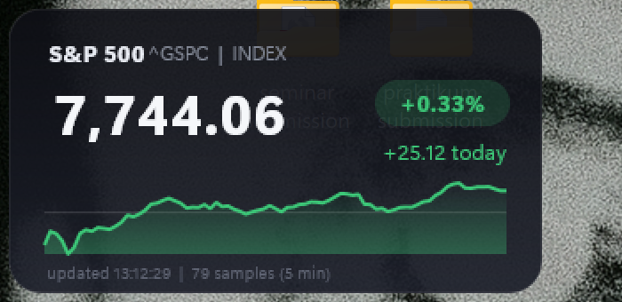

# S&P 500 Desktop Widget for Rainmeter

A live S&P 500 card that is **glued to your desktop wallpaper**, like the old Windows 7 gadgets: it is not a normal window, it sits under your apps, and shows the index price, today's change, the percent change and an intraday sparkline.



*Real screenshot of the widget running on Windows 11. Green means the index is up versus the previous close, red means down, grey means unchanged. The thin horizontal line in the chart is the previous close.*

## Install

1. Install [Rainmeter](https://www.rainmeter.net/) (open source, GPL v2): `winget install Rainmeter.Rainmeter`
2. Copy the `SP500` folder into your Rainmeter skins folder (default: `Documents\Rainmeter\Skins`).
3. Right-click the Rainmeter tray icon, choose **Refresh all**, then open **Skins > SP500 > SP500.ini > Load**.
4. Drag it where you want it. Click the card to open the full chart on Yahoo Finance.

Change `RefreshSeconds` in the `[Variables]` section of `SP500.ini` to control how often it fetches data (default 60 s).

## How it works

The widget is two small files, and the work is split into three layers:

| Layer | File | Job |
|---|---|---|
| Data | `SP500.ini` (`mFeed`, `mBody`) | Fetch the JSON on a timer |
| Logic | `SP500.lua` | Parse, calculate, pick colors, build the chart |
| View | `SP500.ini` (meters) | Draw the card, text and shapes |

### 1. Fetching: one request, one body

`mFeed` is a Rainmeter `WebParser` measure that calls Yahoo Finance's public chart endpoint for `^GSPC`:

```
https://query1.finance.yahoo.com/v8/finance/chart/%5EGSPC?range=1d&interval=5m
```

`range=1d&interval=5m` returns today's session in 5-minute candles, which gives about 79 points on a full trading day. The measure uses the regex `(?s)^(.*)$` to capture the **entire response body** as one string, and `UpdateRate=60` makes it re-fetch every 60 update ticks (1 tick = 1 s). One network call feeds everything, so there is no rate-limit pressure and no inconsistency between the price and the chart.

### 2. Parsing: pattern extraction instead of a JSON library

Rainmeter's Lua has no JSON module, so `SP500.lua` pulls out the three values it needs with Lua patterns:

- `"regularMarketPrice":([%d%.]+)` is the latest price
- `"chartPreviousClose":([%d%.]+)` is the previous session's close
- `"close":%[([^%]]*)%]` is the comma-separated array of 5-minute closes

Gaps in the data come back as `null`. These are dropped with `tonumber()`, which returns `nil` for non-numbers, so the chart only uses real samples. If any of the three values is missing, the widget shows "data error, retrying..." instead of crashing.

A cheap change-detection check (`body == lastBody`) skips all redraw work when the data has not changed since the last tick.

### 3. The math

```
change  = price - previousClose
percent = change / previousClose * 100      (guarded against previousClose = 0)
```

The sign of `change` drives the whole color scheme with a three-way decision: positive is green `60,200,120`, negative is red `235,80,80`, exactly zero is grey. One color triple is reused for the percent text, the change text, the pill background (the same color at alpha 45), the chart line and the chart fill, so the widget always stays visually consistent.

### 4. Number formatting

`fmt()` rounds to two decimals, then inserts thousands separators by reversing the integer part, inserting a comma after every three digits, and reversing back: `7744.06` becomes `7,744.06`.

### 5. The sparkline (the interesting part)

The chart is drawn with Rainmeter's vector `Shape` meter, not a bitmap, which is why it stays sharp on high-DPI screens.

1. **Scale.** `lo` and `hi` are the min and max of all samples, **and the previous close is included in that range**, so the reference line is always inside the chart.
2. **Normalize.** Each sample `v` is mapped to a pixel height: `y = top + h - (v - lo) / (hi - lo) * h`. The x position is spread evenly: `x = x0 + i / (n - 1) * w`. If all values are identical, the span falls back to 1 to avoid dividing by zero.
3. **Build three paths** as strings and push them to the skin with `!SetOption`:
   - `LinePath` is the polyline of all points, drawn with a 2 px stroke and round line joins.
   - `AreaPath` is the same polyline closed down to the baseline, filled with a vertical `LinearGradient` that fades from the trend color at 35% opacity to fully transparent.
   - `RefPath` is a faint horizontal line at the previous-close height, so you can see at a glance whether you are above or below yesterday.

### 6. Why it looks like it is on the wallpaper

Rainmeter skins are placed in a window layer at desktop level, below normal windows. They are rendered with per-pixel alpha, which is why the card shows a rounded translucent gradient instead of a rectangle. Windows' Show Desktop (Win+D) does not hide them.

## Design notes

- Colors, fonts and layout live in `SP500.ini`, while behavior lives in `SP500.lua`. You can restyle the card without touching the logic.
- Font is `Segoe UI Variable Display`, which ships with Windows 11.
- Non-ASCII characters are avoided in strings sent through Rainmeter's bang parser, because they can render as garbled text there.

## Limitations

- Uses an unofficial, undocumented Yahoo Finance endpoint. It is free and needs no API key, but it can change or rate-limit without notice. The data is not guaranteed to be real-time (index quotes are typically delayed by a few minutes) and must not be used for trading decisions.
- Outside market hours the widget shows the last session, with the same previous-close math.
- Windows only (Rainmeter requirement).

## Other symbols

Replace `%5EGSPC` in the URL with another Yahoo ticker (`%5EIXIC` for NASDAQ, `%5EDJI` for Dow, `AAPL` for a stock) and update the label in the `[Title]` meter.

## License

MIT, see [LICENSE](LICENSE).
