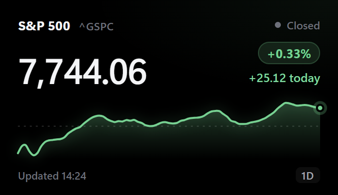
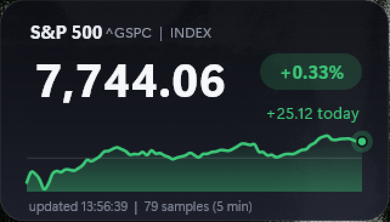

# Umbra

**Desktop widgets that live on your wallpaper.** Umbra pins small, crisp, true-black widgets to the Windows desktop. They sit under your apps, stay visible with Win+D and start with Windows. The first widget is a live **S&P 500** card, and anyone can publish more through a pull request.



## Install

Download `UmbraSetup-<version>.exe` from [Releases](https://github.com/AmineChr54/umbra/releases) and run it. It installs per-user with no admin prompt, and lets you choose whether Umbra starts with Windows. Umbra lives in the tray. Double-click the tray icon, or open Umbra from the Start menu, for **Settings**.

Build it yourself: `powershell -File build.ps1` (needs the .NET 10 SDK, Node and Inno Setup 6). For development: `dotnet build Umbra.slnx`, `dotnet test Umbra.slnx` and `dotnet run --project src/Umbra`.

## Features

- **Settings panel:** start with Windows, refresh interval and animations. Each widget can be turned on or off, configured, resized (50-300 %), locked or reset to its default position. Changes apply live.
- **Edit mode:** turn it on from the tray menu or **My widgets** to arrange your desktop. Unlocked widgets get an outline and a corner handle: drag to move, drag the corner or Ctrl+scroll to resize. Widgets zoom like a web page, so text stays sharp at any size. Locked widgets don't move, resize or zoom, and edit mode is off again after a restart.
- **Community widgets:** the **Browse** page lists every widget in this repo's `widgets/` folder, and installs, updates or removes them in one click. See [CONTRIBUTING.md](CONTRIBUTING.md) to build one.
- **Sandboxed:** a widget can only reach the HTTPS hosts declared in its `widget.json`, and every other request is blocked by the host app.
- **OLED-first:** opaque true-black windows with DWM-rounded corners, so text renders with full DirectWrite quality.
- **Scriptable and agent-ready:** the `umbractl` command line and a built-in MCP server let scripts and AI agents configure widgets, take screenshots and build new widgets.

## Settings

| | |
|---|---|
|  |  |
| **General:** start with Windows, refresh interval, animations. | **My widgets:** edit mode, turn widgets on or off, edit their options and size, lock them or reset their position. |
|  |  |
| **Browse:** install, update or remove community widgets in one click. | **About:** version, source code and links to report issues or build a widget. |

## Automate Umbra (CLI, scripts and AI agents)

The installer puts `umbractl` on your PATH. Every command prints JSON and starts Umbra in the background if it isn't running.

```powershell
umbractl list                         # widgets, their settings, option schema and window bounds
umbractl set sp500 symbol ^IXIC       # change an option; it applies instantly
umbractl move sp500 100 100           # position in physical pixels; also enable/disable, lock/unlock
umbractl configure sp500 --scale 1.5  # 150 % size and zoom (0.5-3, or 150%); also --locked, --enabled, --x, --y
umbractl edit-mode on                 # move/resize/zoom by hand; off, or no argument to read it
umbractl general --refresh 120        # app-wide settings
umbractl install clock                # community catalog: catalog, install, remove
umbractl new my-widget                # scaffold a working widget and show it
umbractl capture sp500 shot.png       # PNG of just that widget (or settings:browse, ...)
umbractl data todo                    # a widget's saved data (umbra.store); data <id> <key> <json> to set
umbractl help                         # everything else
```

**AI agents (MCP).** `umbractl mcp` is a [Model Context Protocol](https://modelcontextprotocol.io) server, so an agent can see and drive your widgets:

```powershell
claude mcp add umbra -- umbractl mcp
```

Then ask Claude, for example, "add a widget that shows the weather in Berlin under my S&P widget". The agent reads `widget_authoring_guide`, writes the widget with `create_widget`, looks at it with `capture` and fixes what it sees. Its tools are `list_widgets`, `configure_widget` (including `scale`), `edit_mode`, `set_general`, `create_widget`, `widget_data`, `capture`, `install_widget`, `remove_widget`, `browse_catalog`, `read_logs` and a few more. Any MCP client works: point it at `umbractl mcp` over stdio.

The server also exposes every installed widget's files as read-only **resources** (`umbra://widgets/<id>/<file>`, same path and extension rules as agent-written files, 5 MB cap) so an agent can read a widget before editing it, and three **prompts**, `new_widget`, `fix_widget` and `restyle_widget`, that walk it through `widget_authoring_guide`, `create_widget` and `capture`.

Under the hood, both talk to the running app over a per-user named pipe with one JSON line per request (`src/Umbra/Protocol.cs`). Other users on the PC can't connect, and agent-made widgets get the same sandbox as community widgets.

## How it works

**Host app (C#, .NET 10 WinForms + WebView2).** It discovers widgets in `widgets/*/widget.json` (built-in) and `%APPDATA%\Umbra\widgets` (community), and opens one borderless window per enabled widget.

- **Desktop pinning** (`DesktopPin.cs`): the window is owned by `Progman`, the desktop shell window, which keeps it visible on Win+D. It's a tool window that never takes focus on its own (it gets the keyboard only when you click into one of its text fields), and every `WM_WINDOWPOSCHANGING` is rewritten to `HWND_BOTTOM`, so apps always cover it.
- **Why it's sharp:** Rainmeter-style skins draw on translucent layered windows, where Windows disables ClearType. Umbra's windows are opaque black, with rounded corners and a hairline border drawn by DWM. On OLED, black pixels are off, so the card still looks like it floats on your wallpaper.
- **Bridge** (`WidgetWindow.cs`, `shared/umbra.js`): pages talk to the host with `postMessage`. `fetchJson` goes through C#, which avoids CORS and checks the host allowlist. `WebResourceRequested` returns 403 for any request to an undeclared host.
- **Single instance + startup:** a mutex plus a named pipe means a second launch opens Settings in the running copy. "Start with Windows" is the `HKCU\...\Run\Umbra` value, which the installer and the Settings toggle both read and write.
- **Community catalog** (`scripts/catalog.mjs`, `.github/workflows/widgets.yml`): pull requests are validated in CI, and merges regenerate `widgets/index.json`. The app downloads files into a temp folder, checks paths, file types, size and id, and only then installs them.

### S&P 500 algorithms (`widgets/sp500`)

1. **Data:** Yahoo Finance chart API (`range=1d&interval=5m`, or `5d/15m`), parsed as real JSON: `regularMarketPrice`, `chartPreviousClose`, the closes and timestamps, and the trading period for the open/closed dot. `null` gaps are dropped.
2. **Math:** `change = price - prevClose` and `percent = change / prevClose * 100`. The sign picks the theme: green, red or grey.
3. **Denoise:** a 3-point moving average on interior samples. The endpoints stay exact, so the live dot sits on the real last price.
4. **Scale:** the y-range always includes the previous close, so the dashed reference line stays inside the chart.
5. **Smooth curve:** a Catmull-Rom spline converted to cubic Beziers, with control points `C1 = P1 + (P2 - P0)/6` and `C2 = P2 - (P3 - P1)/6`. It passes through every sample with no corners.
6. **Motion:** the price counts with ease-out-cubic, `1 - (1 - t)^3`, and the line draws in via `stroke-dashoffset`. Both are skipped when the window is covered or animations are off.
7. **Hover:** a binary search on x finds the nearest sample for the crosshair tooltip.

## Contributing and roadmap

Umbra is community-built. The [roadmap board](https://github.com/users/AmineChr54/projects/5) tracks what's next, from Backlog to Done, and every new issue lands there automatically.

- **Build a widget:** [CONTRIBUTING.md](CONTRIBUTING.md) and the [widget SDK](docs/widget-sdk.md).
- **Work on the app:** pick a `good first issue`, and read [CLAUDE.md](CLAUDE.md) for the architecture and security rules (AI coding agents read it too).
- **Found a bug?** [Open an issue](https://github.com/AmineChr54/umbra/issues/new/choose). For security problems, see [SECURITY.md](SECURITY.md).

## Rainmeter edition

The original lightweight Rainmeter skin is still in [`extras/rainmeter`](extras/rainmeter/SP500).



## Limitations

Market data comes from Yahoo's unofficial endpoint. It may be delayed or change without notice, so don't use it for trading. Umbra is Windows 10 1809+ / Windows 11 only.

## License

MIT, see [LICENSE](LICENSE).
