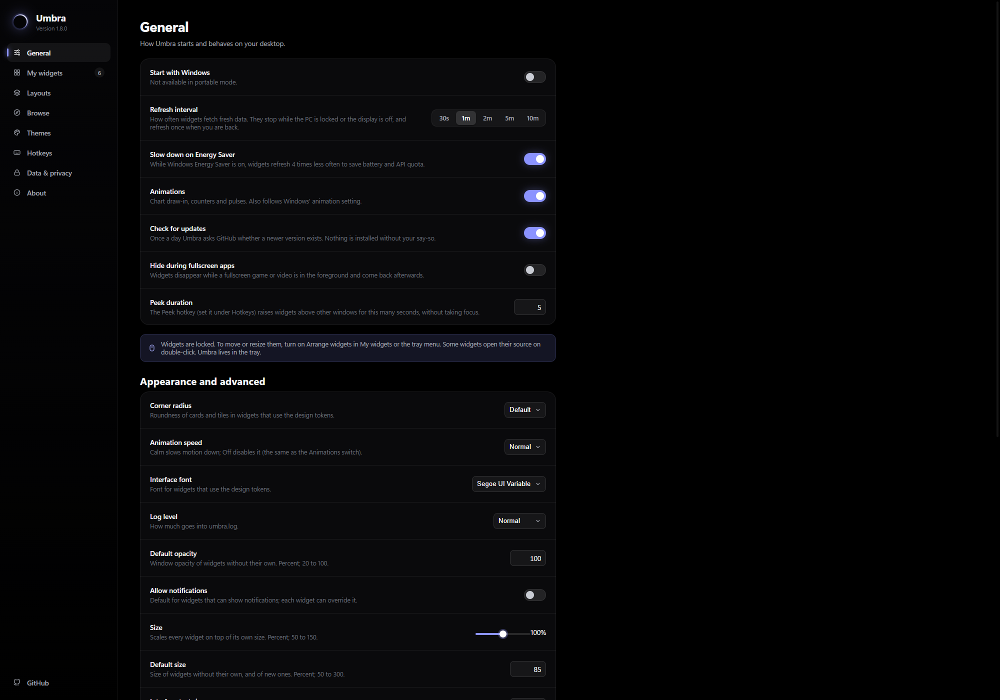
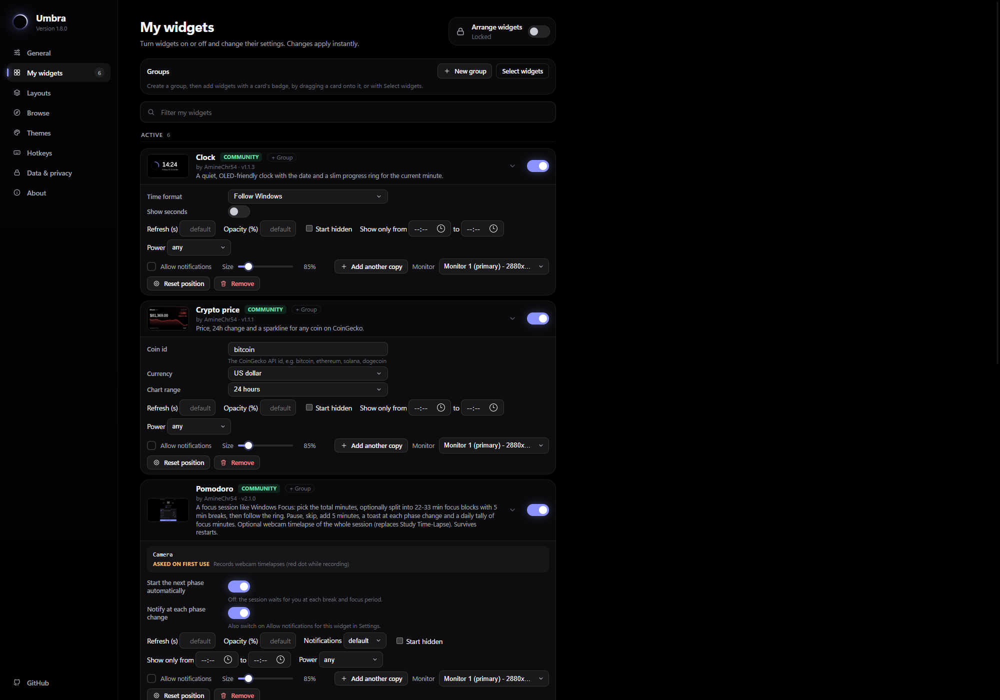
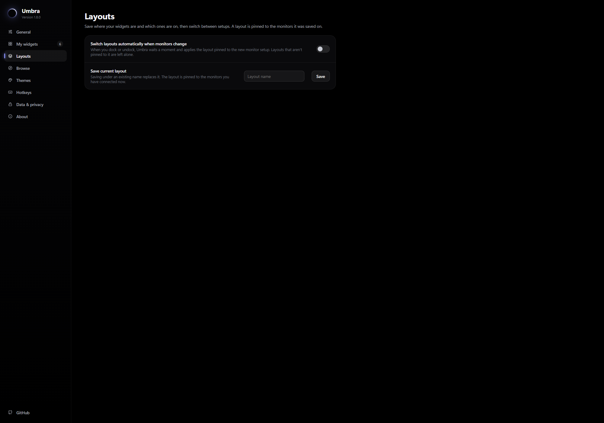
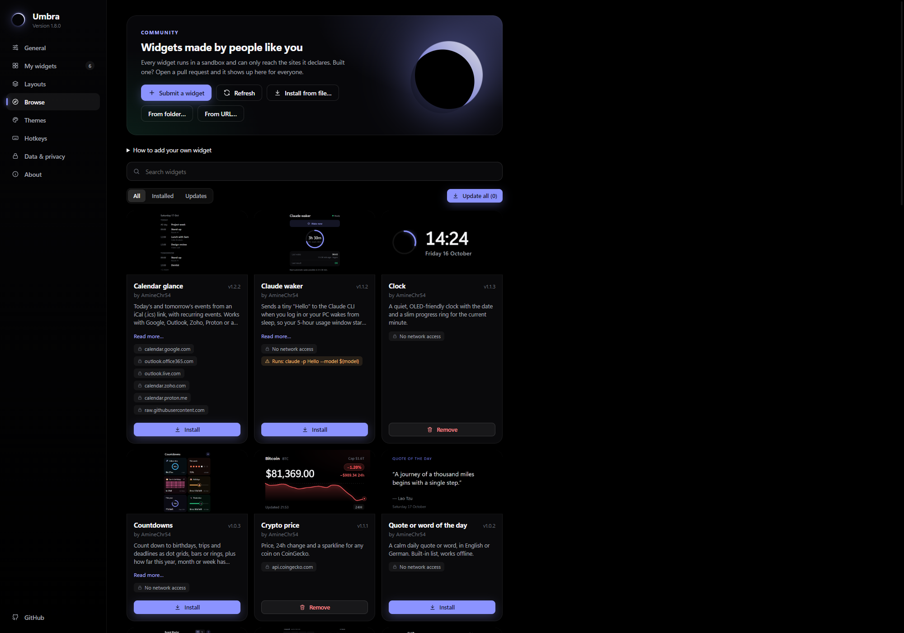
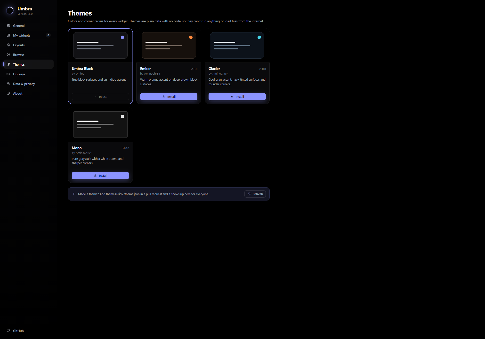
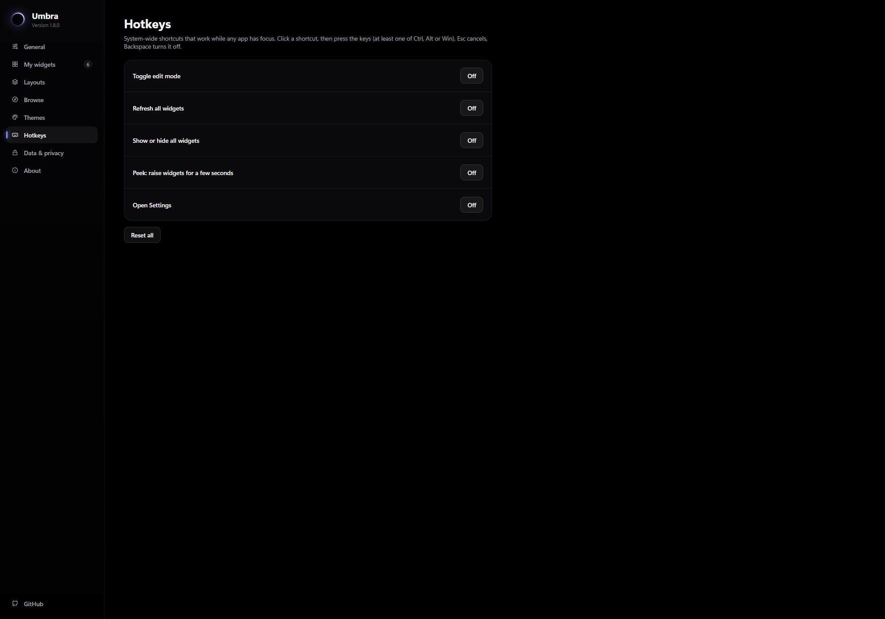
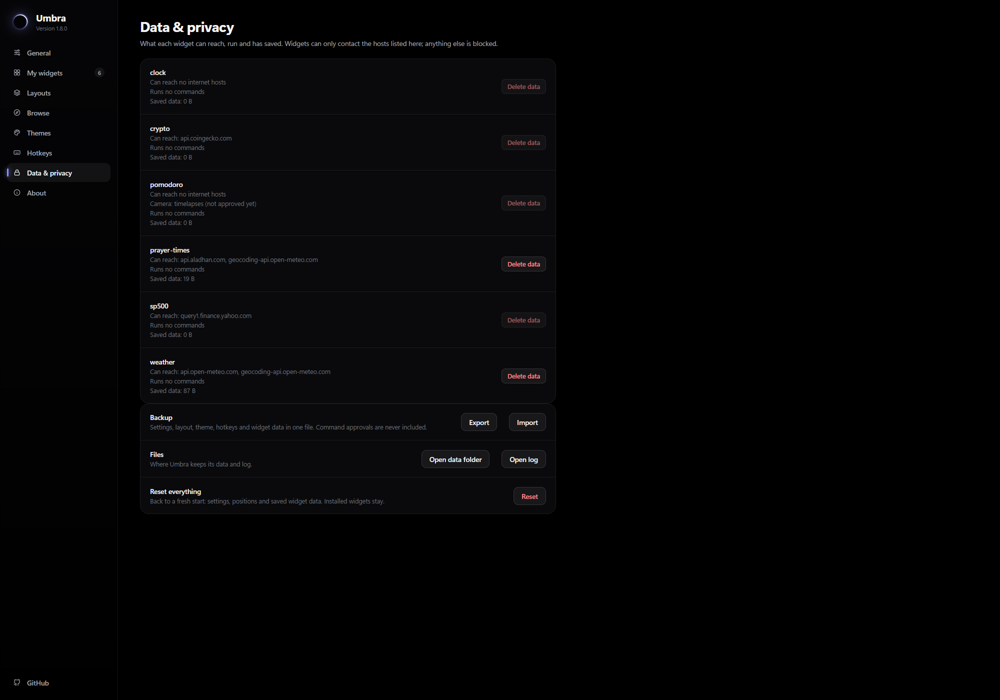
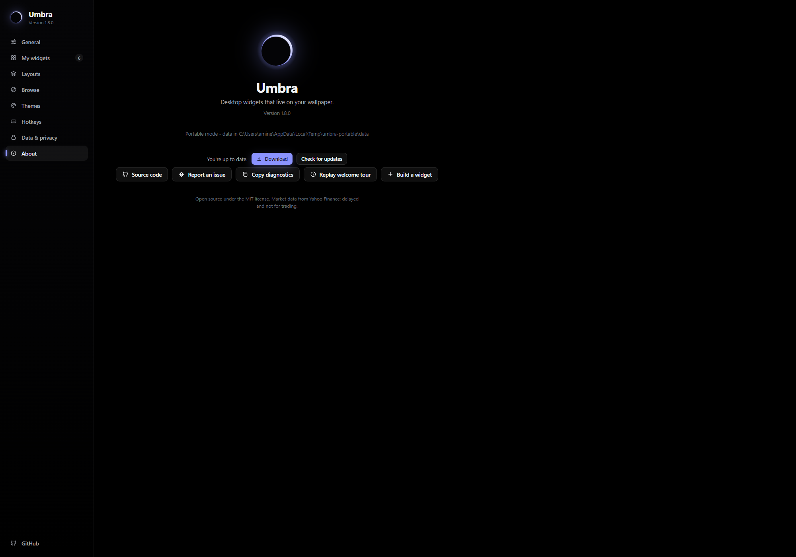
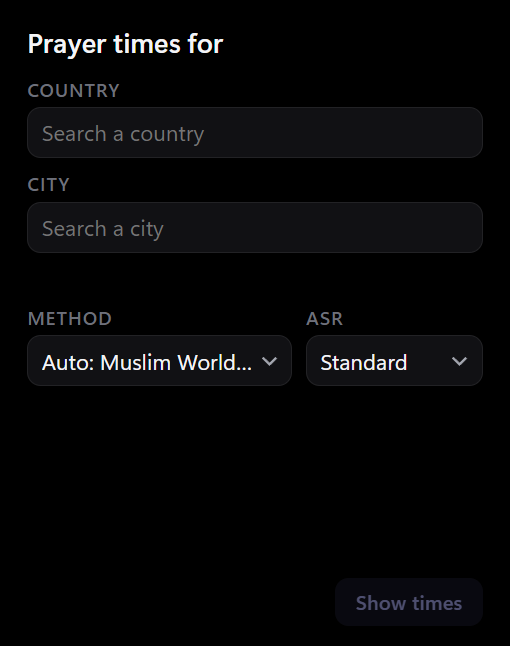

# UX audit (#237)

Audit of Umbra 1.8.0 plus everything merged since (global lock, groups strip, Active/Not enabled list, global defaults,
package install). Captured with `umbractl capture` from an isolated portable copy (so no desktop screenshots, see
`CLAUDE.md`). Principles from the issue: fewer clicks on the common path, clear empty states, one spacing and type scale,
keyboard and contrast, one concept per control, keep `#000` and the tokens.

Priorities: **P1** hurts the common path or misleads, **P2** visible roughness worth a ticket, **P3** polish (listed, no ticket).

## What is already good

- The sidebar, page titles and the card/row pattern are consistent across General, Layouts, Hotkeys and Data & privacy.
- **Arrange widgets** (top right of My widgets) is one obvious switch with its state spelled out ("Locked"). That is the
  common path (enable, place, lock) in three clicks.
- Empty and first-run states are covered by the new welcome tour (#241, #242) and Browse's hero.
- Widgets keep the black, tabular-number look: Clock, Weather, S&P 500 and Crypto need nothing.

## Settings pages

| Page | Capture | Findings |
|---|---|---|
| General |  | F3 (two size controls) |
| My widgets |  | F1, F2 |
| Layouts |  | P3-a |
| Browse |  | F4, F5, P3-b |
| Themes |  | P3-c |
| Hotkeys |  | F8 (fixed here) |
| Data & privacy |  | F6 |
| About |  | F7 (fixed here) |

## Findings

### P1

**F1. Two notifications controls on one card** ([#281](https://github.com/AmineChr54/umbra/issues/281)).
Pomodoro shows a *Notifications* dropdown and an *Allow notifications* checkbox for the same thing. Keep one tri-state
control (Default / On / Off) that reads the global default from #232.

**F2. The per-card options panel is a wrapped soup** ([#282](https://github.com/AmineChr54/umbra/issues/282)).
Refresh, Opacity, Start hidden, Show only from/to, Power, notifications, Size, Add another copy and Monitor wrap over
3 to 4 lines with mixed label-left rows, inline labels, checkboxes next to toggles. Use one two-column grid, keep Size,
Monitor and Start hidden visible and fold the rest under Advanced (the same idea #231 applied to widget options).

**F3. Two size controls on General** ([#283](https://github.com/AmineChr54/umbra/issues/283)).
"Size" (scale every widget, 50 to 150 %) and "Default size" (new widgets, 50 to 300 %) sit together with near-identical
help text. Rename and explain, or merge. Follow-up to #232 and #233, not a duplicate of them.

### P2

**F4. Five install buttons in the Browse hero** ([#284](https://github.com/AmineChr54/umbra/issues/284)).
Submit a widget, Refresh, From file, From folder and From URL wrap onto two rows with mixed icon/no-icon styles. Group the
three local sources under one "Install from..." menu; make Refresh a quiet icon button.

**F5. "Update all (0)" is the primary button** ([#285](https://github.com/AmineChr54/umbra/issues/285)).
A call to action that does nothing. Hide or disable it until an update exists.

**F6. Data & privacy lists raw ids** ([#286](https://github.com/AmineChr54/umbra/issues/286)).
`prayer-times`, `sp500` instead of the names used everywhere else; Delete data is offered on 0 B rows.

**F7. About shows "Download" while "You're up to date"** (**fixed in this PR**).
`.btn { display: inline-flex }` beat the `hidden` attribute, so the update button was always visible. A global
`[hidden] { display: none !important; }` in `settings.css` fixes it for every component, and the same root cause was
behind the welcome dialog's Back/Skip buttons.

**F8. Hotkeys still says "Toggle edit mode"** (**fixed in this PR**). The global lock is called *Arrange widgets* since
#234; the hotkey label is now "Arrange widgets (lock or unlock)".

**F9. Prayer Times setup screen** ([#287](https://github.com/AmineChr54/umbra/issues/287)).

"Prayer times for" over two empty fields, a big empty area, and a disabled "Show times" that never says why.

**F10. Surfaces that need a human** ([#288](https://github.com/AmineChr54/umbra/issues/288)).
The host-drawn right-click menu, the edit pill, the tray menu and the native install-review box are not WebViews, so
`umbractl capture` cannot show them; they were audited from the code only. The review box uses stock light Windows chrome in
a black app. Needs a pass on real hardware (contrast, focus order, keyboard, a 10+ item permission list).

### P3 (no ticket)

- **P3-a Layouts**: with no saved layouts the page only shows the save form; a one-line "No layouts yet" would anchor it.
- **P3-b Browse**: permission chips can run to six lines (Calendar glance) and cards stretch to the tallest neighbour.
- **P3-c Themes**: the third row holds one orphaned card; a 4-up grid would fit four themes.
- **P3-d Pomodoro**: "Skip breaks" is on by default, so a 60-minute session says "You'll have no breaks".
- **P3-e** Settings content is capped at about 830 px; on a wide window the right half is empty (fine, but check at 4K).
- **P3-f** Number inputs (Peek duration, Default opacity) show units only in the help text.

## Widgets audited

Clock, Weather, S&P 500, Crypto, Pomodoro, Prayer Times (see `ux-audit/widget-*.png`). Only Prayer Times (F9) and the
Pomodoro default (P3-d) need work; the rest match the design rules.

## Duplicates of existing work

The global lock (#234), group strip (#235), Active-first list (#236), defaults (#232), smaller sizes (#233) and card
folding (#231) all landed and show up well in the captures; nothing here repeats them. F1 to F3 build on them.

## Not covered

First-run empty states of My widgets and Browse (a fresh profile starts on Browse and the welcome tour), Safe mode and the
multi-monitor layouts: they need a second monitor or a clean profile and are tracked in #5.
