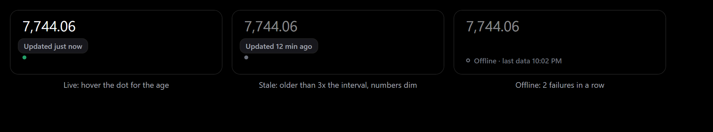

# Umbra widget SDK

An Umbra widget is a small web page (HTML, CSS, JS) in its own folder. Umbra opens it in a borderless,
true-black, desktop-pinned window (WebView2, the Edge engine) and gives it a tiny JavaScript SDK.
This file is the complete reference, for both people and AI agents. It ships with Umbra, and the MCP
tool `widget_authoring_guide` returns it.

**More:** [Tutorial: your first widget in 10 minutes](widgets/tutorial.md) ·
[Cookbook of recipes linked to real widgets](widgets/cookbook.md) ·
[Coming from browser extensions (comparison and manifest field index)](widgets/from-browser-extensions.md).

## Contents

- [Folder layout](#folder-layout) · [widget.json](#widgetjson) · [The page](#the-page)
- [JavaScript API](#javascript-api-windowumbra) · [Freshness and offline](#freshness-and-offline)
- [umbra.css tokens](#umbracss-tokens) · [Themes](#themes) · [Design rules](#design-rules)
- [Running local commands](#running-local-commands) · [Webcam timelapse](#webcam-timelapse) · [Sandbox](#sandbox-what-a-widget-can-and-cannot-do)
- [Develop with umbractl](#develop-with-umbractl-or-an-ai-agent) (validate, pack, dev) · [Publish and share](#publish)
- Manifest versioning: `manifestVersion` (default 1) is the widget.json format; `minUmbraVersion` is the oldest Umbra that runs the widget.
  An app that is too old refuses to install or load it with an "Update Umbra" message and Browse greys it out. The per-field
  "since" list is in the [manifest field index](widgets/from-browser-extensions.md#manifest-field-index).

## Folder layout

```
my-widget/            folder name = widget id (lowercase letters, digits, dashes; 2-40 chars)
  widget.json         manifest (required)
  index.html          entry page (required, or whatever "entry" names)
  preview.png         screenshot for the Browse page (recommended: 2x, black background)
  icon.png            optional tab icon for widget groups (64x64 PNG, light grey on transparent; "icon": "icon.png" in widget.json)
  (users can also pick any of the bundled shared/tabicons for a tab in Settings > Tab groups, or with `umbractl groups icon <id> <name>`; their choice wins over icon.png; a widget copy can also suggest one with `umbra.setTabIcon`, see below)
  ...                 .js .mjs .css .svg .png .jpg .webp .gif .woff .woff2 .ttf .otf .json .txt .md (5 MB total)
```

Nothing ships inside the app; every widget, including S&P 500, is installed from Browse. Community and locally created widgets live in
`%APPDATA%\Umbra\widgets\<id>` and are served from `https://community.umbra.local/<id>/`.

## widget.json

```json
{
  "$schema": "https://raw.githubusercontent.com/AmineChr54/umbra/main/schemas/widget.schema.json",
  "id": "weather",
  "name": "Weather",
  "description": "Current temperature and conditions for one city.",
  "author": "your-github-name",
  "version": "1.0.0",
  "entry": "index.html",
  "preview": "preview.png",
  "width": 300,
  "height": 160,
  "defaultPosition": { "x": 24, "y": 420 },
  "permissions": { "hosts": ["api.open-meteo.com"] },
  "options": {
    "city":    { "label": "City", "type": "text", "default": "Berlin", "hint": "Shown under the field" },
    "units":   { "label": "Units", "type": "select", "default": "c",
                 "choices": [{ "value": "c", "label": "Celsius" }, { "value": "f", "label": "Fahrenheit" }] },
    "decimals":{ "label": "Decimals", "type": "number", "default": 0, "min": 0, "max": 2, "step": 1 },
    "compact": { "label": "Compact mode", "type": "toggle", "default": false }
  }
}
```

| Field | Rules |
|---|---|
| `id` | Equals the folder name. `^[a-z0-9][a-z0-9-]{1,39}$` |
| `name`, `description`, `author` | Required, non-empty |
| `version` | Required, `1.2.3`. Bump it on every change (users get an Update button) |
| `changelog` | Optional, up to 500 characters: what changed in this version. Shown when an update asks for new access, and carried in the catalog index |
| `entry` | Default `index.html` |
| `width`, `height` | Integers 80-1200, **logical** pixels (Umbra scales for the display's DPI and the user's size setting) |
| `themeable` | Default `true`. `false` keeps your own look: the user's [theme](#themes) is not applied to the widget |
| `private` | Default `false`. `true` marks a widget shared [from a file](#share-without-the-catalog-the-umbrawidget-package), not the catalog: a Private badge in My widgets, no catalog updates, and a catalog widget with the same id can't replace it. Grants no extra access; refused in the public catalog |
| `defaultPosition` | `{x, y}` from the top-left of the primary work area, logical pixels. Omit to start top right |
| `permissions.notifications` | Optional boolean. Needed for `umbra.notify`; the user must also switch "Allow notifications" on for the widget in Settings (off by default) |
| `permissions.camera` | Optional boolean. Needed for `umbra.timelapse` (webcam stills rendered to an MP4 by the host). Listed in the update review box |
| `permissions.media` | Optional: `"read"` (`umbra.media.nowPlaying`) and/or `"control"` (`umbra.media.control`). Browse shows them |
| `permissions.system` | Optional: any of `"cpu"`, `"memory"`, `"network"`. Needed for `umbra.system()`; Browse shows them as "Reads cpu usage" etc. |
| `permissions.hosts` | Every HTTPS hostname the widget may reach. **All other requests are blocked** (fetch, XHR, images, scripts, fonts). `[]` for offline widgets |
| `permissions.commands` | Local programs the widget may start with `umbra.run`. Empty by default. See [Running local commands](#running-local-commands) |
| `options` | Settings form shown in **My widgets**, in this order. Types: `text`, `number` (`min`/`max`/`step`), `select` (needs `choices`), `toggle`. Optional `hint` (text under the field), `group` (options with the same group fold into one collapsed section titled with it) and `advanced: true` (folds into a collapsed "Advanced" section); use them when a widget has many options |

The JSON Schema is in [`schemas/widget.schema.json`](../schemas/widget.schema.json).

## The page

```html
<!doctype html>
<html lang="en">
<head>
  <meta charset="utf-8">
  <link rel="stylesheet" href="https://umbra.local/shared/umbra.css">
  <link rel="stylesheet" href="style.css">
</head>
<body>
  <main id="app"></main>
  <script src="https://umbra.local/shared/umbra.js"></script>
  <script src="main.js"></script>
</body>
</html>
```

```js
// main.js
umbra.every(async () => {                       // now, then every refreshSeconds (user setting, 30-600 s)
  const { city, units } = umbra.options;
  const geo = await umbra.fetchJson(`https://api.open-meteo.com/v1/forecast?latitude=52.52&longitude=13.41&current=temperature_2m`);
  document.getElementById("app").textContent = `${city}: ${geo.current.temperature_2m}°`;
  umbra.rendered();
});
umbra.onSettings(() => { /* options changed: re-render without refetching if you can */ });
```

## JavaScript API (`window.umbra`)

Talk to the host only through `window.umbra`. Don't use `window.chrome.webview` (or any other host bridge) directly: it
is WebView2 on Windows, and other platforms use a different one that `umbra.js` hides.

| API | Description |
|---|---|
| `umbra.ready` | Promise, resolves when the host has sent this widget's settings |
| `umbra.options` | This widget's option values, e.g. `{ city: "Berlin", units: "c" }` |
| `umbra.settings` | `{ refreshSeconds, animations, locked, scale, locale, hour12, editMode, paused, energySaver, options }`. `scale` is the user's size (0.5-3), `editMode` is true while the user arranges widgets, and `locked` is its opposite (one global lock: widgets are locked unless the user turns on Arrange widgets). `paused` is true while the PC is locked or the display is off; `energySaver` is true while Windows Energy Saver is on and the user allows slowing down, in which case `refreshSeconds` is already 4x longer. Both arrive through `umbra.onSettings` |
| `umbra.widget` | `{ id, instance, name }`. `id` is the widget (the folder); `instance` identifies this copy: the same as `id` for the first copy, `"<id>#2"`, `"<id>#3"`... for copies the user added |
| `umbra.every(fn)` | Calls `fn` once ready, then every `refreshSeconds`. Rescheduled when the user changes the interval, also run on "Refresh all", after the PC resumes from sleep, when the network comes back and after a long lock (at most once per 10 s). Errors are caught and logged. Does not run while `umbra.settings.paused` and runs once when the PC is unlocked or the display is back on |
| `umbra.onSettings(fn)` | Called with the new settings whenever the user changes anything |
| `umbra.onTimeChanged(fn)` | `fn()` runs when the system clock or time zone changes (travel, clock correction after resume). Widgets with no listener get their `umbra.every` callbacks run instead. See [Time changes](#time-changes) |
| `umbra.fetchJson(url)` | `GET` JSON through the host: no CORS issues, 25 s timeout. Rejects unless the URL is HTTPS and its host is in `permissions.hosts` |
| `umbra.system()` | Resolves machine totals for the kinds declared in `permissions.system`: `cpu.percent`, `memory.{totalBytes,usedBytes,percent}`, `network.{downBytesPerSec,upBytesPerSec}`. Read-only numbers; no process or adapter names. Rejects without `permissions.system`; call it from `umbra.every` (shared sample, at most 2 per second) |
| `umbra.notify({ title, body?, url?, tag?, actions? })` | Shows a real Windows toast with the widget's name as attribution. Clicking the toast opens its own `url` in the browser (**`url` must be HTTPS on a host in `permissions.hosts`**, like `fetchJson`; anything else rejects the call). A click on a toast still in Notification Center from an earlier Umbra session may do nothing: Umbra only handles clicks while it is running. `tag` (up to 64 chars) makes a later toast with the same tag replace this widget's earlier one; without it toasts stack. `actions` is up to 2 buttons `{ id, label }` (label up to 30 chars) routed back to `umbra.onNotificationAction`. Windows Do Not Disturb and Focus apply. Rejects without `permissions.notifications`, when the user's switch is off, or past 5 per 10 minutes per widget. Logged in `umbra.log`. If toasts can't be set up, Umbra falls back to a tray balloon (no buttons, and one click target shared by all of them). Toasts need an AppUserModelID: the installer provides one; a portable or source run registers its own under `HKCU\Software\Classes\AppUserModelId` (the one registry write portable mode makes) |
| `umbra.onNotificationAction(fn)` | `fn({ id, tag })` when the user clicks a toast button: `id` is the action's id, `tag` the toast's tag or `null`. Only fires while the widget is open; a button on a toast from an earlier Umbra session does nothing |
| `umbra.media.nowPlaying()` | Resolves the current Windows media session `{ title, artist, album, app, status, playing, canPlay, canPause, canNext, canPrevious, art? }` (`art` is a PNG/JPEG data URL, omitted over 512 KB) or `null`. Needs `permissions.media` `"read"` |
| `umbra.media.control(cmd)` | `play`, `pause`, `toggle`, `next` or `previous`; resolves true when the session accepted it. Needs `"control"` and a physical click on the widget within the last 2 s |
| `umbra.timelapse.start({ interval, length, fps? })` | Records a webcam timelapse in the host: one still every `interval` seconds (1 to 3600) until there are enough for `length` seconds of video (up to 3600) at `fps` (1 to 60, default 30); recording is refused over 12 h and always stops at 12 h. The host then renders an MP4 (H.264, 720p, Windows' own encoder, no external program) into the user's folder (default `Videos\Umbra Timelapses`) as `Timelapse <date> <time>.mp4` and deletes the stills. The video is `frames / fps` long, exact to 100 ns per still; a session stopped early or at the cap is shorter. Needs `permissions.camera`, an enabled visible widget, the user's one-time camera approval and a left click on it within the last 2 s. One recording at a time across all widgets. A red dot shows on the widget (host-drawn, the page can't hide it) and in the tray while the camera is on. The first start asks the user (once per widget). Resolves the state below |
| `umbra.timelapse.stop()` / `.cancel()` / `.status()` | `stop` ends recording and renders what was captured; `cancel` deletes the stills without a video; `status` resolves the current or last state `{ state: "idle"\|"recording"\|"rendering", framesCaptured, framesPlanned, startedAt, endsBy, plan, file, error, capReached, cancelled, folder }` |
| `umbra.timelapse.chooseFolder()` | Opens the host's folder dialog (after a click on the widget) and resolves `{ folder (its name only), changed }`. The page never passes a path |
| `umbra.timelapse.onChange(fn)` | `fn(state)` on start, each still, rendering and the end (`state: "idle"` with `file` or `error`) |
| `umbra.run(commandId, params?)` | Runs a command declared in `permissions.commands` and resolves `{ exitCode, stdout, stderr, timedOut, truncated, durationMs }`. Rejects when the command isn't declared, isn't approved yet, or `params` are invalid. See below |
| `umbra.fetchText(url)` | Like `fetchJson`, but resolves with the response body as a string (up to 2 MB), for Markdown, CSV or HTML |
| `umbra.status` | Data freshness, tracked from every `fetchJson`/`fetchText`: `state` (`"none"`, `"live"`, `"stale"`, `"offline"`), `lastOk` (Date or `null`), `failures`, `ok(at?)`, `failed(err)`, `onChange(fn)`. See [Freshness and offline](#freshness-and-offline) |
| `umbra.store.get(key, fallback?)` | Promise of this widget's saved value for `key` (any JSON), or `fallback` when it was never set |
| `umbra.store.set(key, value)` | Saves a JSON value. Rejects when the widget's data would pass 1 MB |
| `umbra.store.remove(key)`, `umbra.store.keys()` | Delete one key; list the keys |
| `umbra.store.onChange(fn)` | `fn(key)` runs when the data was changed from outside the widget (`umbractl data`, MCP). `key` is `null` when everything was cleared |
| `umbra.requestFocus()` | Ask for the keyboard, e.g. before focusing an input you create on double-click. Only honoured right after the user pressed the mouse on the widget (inputs and textareas ask automatically) |
| `umbra.openUrl(url)` | Opens an http(s) link in the user's browser (links never navigate the widget) |
| `umbra.setTabIcon(name)` | Suggests this copy's icon in a tab group's strip, e.g. per `view` option so Overview, Board and Pet copies look different by default. `name` is one of the bundled [`shared/tabicons`](../shared/tabicons/index.json) names such as `"chart-line"`, or `null` to clear. Call it again whenever the view changes: the host stores it (`SuggestedTabIcon` in `settings.json`) and redraws the strip at once. See [Tab icon suggestions](#tab-icon-suggestions) |
| `umbra.rendered()` | Call once the first real frame is drawn; screenshots wait for it |
| `umbra.tween(from, to, ms, onFrame)` | Ease-out-cubic number animation; jumps straight to `to` when motion is off or the window is hidden |
| `umbra.locale` | The user's Windows region format as a BCP-47 tag (`"de-DE"`). Pass it to `Intl.*` and `toLocale*String` instead of `[]` or a hard-coded `"en-US"`; `"en-US"` before the host has sent settings |
| `umbra.hour12` | `true` when Windows (Region > Time format) uses a 12-hour clock. Pass it as `hour12` to `Intl.DateTimeFormat` or `toLocaleTimeString`, and let an option override it if you offer one |
| `umbra.fmt(n, decimals = 2)` | `7744.06` to `"7,744.06"`, or `"7.744,06"` when Windows is set to German: it follows `umbra.locale` |

Plain `fetch()` also works for declared hosts if the server allows CORS; `umbra.fetchJson` always works.

**Several copies.** The user can run a widget more than once (**My widgets > Add another copy**, or `umbractl add-instance`), for
example two stock tickers. Each copy is a separate window with its own options, position, size and `umbra.store` data, so a widget
needs no extra code: read `umbra.options` and `umbra.store` as usual. Don't use `localStorage` for per-widget state, since
copies share it. Use `umbra.widget.instance` only if you need to tell copies apart.
Example: `widgets/hearth` is one widget id with a `view` select option, so users add one copy per view and group them as
tabs. It is also an example of a widget that syncs through a small server (a relay) with GET-only `umbra.fetchJson`
calls and adaptive polling (`umbra.settings.refreshSeconds` when idle, faster only while the user is drawing, nothing
while `umbra.settings.paused`). Because `umbra.store` is per copy, its copies share one pairing through a
`BroadcastChannel` with a user approval; see [its README](../widgets/hearth/README.md).

**Time changes.** Windows tells Umbra when the clock is set or the time zone changes, and Umbra tells every widget
(within about half a second). `new Date()` already returns the new time, but anything you computed earlier
("today", a countdown target, a timer set for midnight) is stale until you recompute it, so do that in
`umbra.onTimeChanged`. Don't poll for the next day either; schedule one timer for the next local midnight and
set it up again on every time change:

```js
let midnight;
function scheduleMidnight() {
  clearTimeout(midnight);
  const now = new Date();
  const next = new Date(now.getFullYear(), now.getMonth(), now.getDate() + 1); // local midnight
  midnight = setTimeout(() => { render(); scheduleMidnight(); }, next - now + 50);
}
umbra.onTimeChanged(() => { render(); scheduleMidnight(); });
scheduleMidnight();
```

**Saving data.** Options are for settings the user picks in **My widgets**. Anything the widget itself creates
(a task list, events, "already seen" ids) goes in `umbra.store`. It is private to the widget, survives restarts
and widget updates. Removing a community widget in Settings keeps its data for 7 days (Undo restores it); `umbractl remove` deletes it at once. It lives in
`%APPDATA%\Umbra\data\<id>.json` (`<app>\data\data\<id>.json` in portable mode, where `%APPDATA%\Umbra` means the `data` folder next to `Umbra.exe`). Don't use `localStorage`: every widget shares one origin, so other widgets could read it.

```js
const tasks = await umbra.store.get("tasks", []);
tasks.push({ title: "Read chapter 3" });
await umbra.store.set("tasks", tasks);
umbra.store.onChange(async () => render(await umbra.store.get("tasks", [])));
```

**Dragging** is built in: holding the mouse button and moving more than 4 px moves the window while the
user arranges widgets (edit mode); otherwise widgets are locked. Put `data-no-drag` on buttons or links that need normal clicks; inputs, textareas, selects and
`contenteditable` elements never start a drag.

**Zoom, free resize and edit mode.** Users can resize any widget freely (right edge, bottom edge or corner in edit mode),
each side from 50 % to 300 % of `widget.json`'s `width` x `height`. Umbra zooms the page by the smaller of the two
stretches (like browser zoom) and your page lays out in the window size divided by that zoom. A widget that is only
made wider or taller keeps its zoom and gets more room; one made bigger on both sides is also drawn larger. At the
default size the page lays out at exactly the manifest size and renders sharply. Don't scale it yourself:
- Use CSS pixels and layout as usual, and let the page fill its window (`height: 100%`, flex, grid, `%`/`fr` sizes) so
  it uses extra room. `window.innerWidth`/`innerHeight` is the manifest size only at the default size; read them (or
  use container queries) instead of hard-coding it. Fixed-size pages just show empty space.
- `devicePixelRatio` includes the zoom. Canvas code that sizes its backing store by `devicePixelRatio` stays crisp;
  redraw on `umbra.onSettings` when `umbra.settings.scale` changes.
- In **edit mode** (`umbra.settings.editMode`, switched from the tray, a hotkey or Settings > My widgets > Arrange widgets), every widget is covered by
  Umbra's overlay with an outline and a corner handle: presses move the widget, the handle resizes it and Ctrl+wheel
  zooms it. The last widget pressed is selected (stronger outline) and takes the keyboard; its arrow keys nudge it
  (1 px, Shift: 10 px or one grid step), only while the host sees the key physically down. Mouse presses on your page are taken by the overlay then, so don't rely on interaction (capture-phase listeners and keyboard events can still reach it). Locked widgets are left alone. A page can't
  resize or zoom itself: in edit mode, the host resizes only during a real mouse press on the handle and zooms only
  while Ctrl is physically held over the widget.

**Typing.** Widgets never steal focus from the app you're using. Pressing the mouse on a text field hands the
widget the keyboard. Umbra checks that a mouse button is physically down over the widget, so a widget can't take
focus on its own. If you create an input in code (say, rename on double-click), call `umbra.requestFocus()` first.
See `widgets/todo` for an example.

**Appearance**: the user can pick a corner radius (`--radius-s/m/l` are overridden after the theme) and calm motion, which sets `--motion-scale: 2`; multiply your durations with `calc(200ms * var(--motion-scale, 1))`. `umbra.onSettings` reports the widget's own refresh interval as `refreshSeconds` when the user set one.

**More appearance options**: the user can also set an accent color (`--accent`, `--accent-strong`, `--accent-soft`, also passed as `umbra.settings.accent`, empty = theme; "Match Windows accent" follows the system accent live, lightened if it is too dark for black), light text (brighter `--text*`), an interface font (`--font`, `--font-display`), a text size (`--font-scale`, applied to the base font size of `umbra.css`; use `em`/`rem` to follow it), a window border on/off and color, and "reduce transparency" (solid `--line*` and `--accent-soft`, opaque windows). Avoid translucent colors of your own if you want to honor it.

**Motion**: `<html data-motion="on|off">` reflects the user's Animations setting and Windows' reduced-motion
preference. `umbra.css` turns off CSS animations when it is `off`.

## Freshness and offline

A widget that fetches should tell the user when its numbers are old. The SDK does the bookkeeping, so every widget looks the same:



- Each `umbra.fetchJson` / `umbra.fetchText` outcome is recorded (HTTP errors and timeouts are failures). Nothing to call.
- `state` is `live` after a success, `stale` when the data is older than 3x the refresh interval, and `offline` after two
  failures in a row, or a failure when nothing has loaded since the widget started. `none` until the first fetch finishes.
- `<html data-stale>` is set while the state is `stale` or `offline`; dim your numbers with CSS, e.g.
  `html[data-stale] .price { opacity: 0.55; }` (keep it to `opacity`; the transition is off with `data-motion="off"`).
- `<umbra-status></umbra-status>` is an optional element, styled by `umbra.css` with tokens: a small dot (`--up` live, `--text-3`
  stale, a ring offline). Hover shows "Updated 3 min ago"; offline keeps "Offline · last data 10:42" visible. Put it in a
  footer; use `placement="below-end"` in a top-right header so the hover text opens downwards. It is hidden while the state is `none`.
- Override when data arrives some other way: `umbra.status.failed(err)` for a response you can't use (a fetch's own Error is only
  counted once), and `umbra.status.ok(new Date(savedAt))` to show data restored from `umbra.store` as "last data" at startup.
- `umbra.status.onChange(fn)` calls `fn(state)` when the state changes.

To see the offline state, start Umbra from a shell with `UMBRA_SIMULATE_OFFLINE=1`: every host fetch fails. Widgets that depend on a
newer SDK than the installed app should call it as `umbra.status?.failed(err)`.

## umbra.css tokens

`--text`, `--text-2` (secondary), `--text-3`, `--accent`, `--up` (green), `--down` (red), `--flat`, the
Segoe UI Variable font stack, and `.num` for `font-variant-numeric: tabular-nums`. Read
[`shared/umbra.css`](../shared/umbra.css) for the full list.

**Always use the tokens instead of hard-coded colors**, so the user's theme restyles your widget. The tokens a
theme can change:

| Token | Default | Used for |
|---|---|---|
| `--bg` | `#000` | Window background |
| `--surface-1`, `--surface-2`, `--surface-3` | `#0a0a0c`, `#111114`, `#17171c` | Cards and raised areas |
| `--line`, `--line-strong` | white at 7 % / 12 % | Hairlines and borders |
| `--text`, `--text-2`, `--text-3` | `#f4f5f7`, `#a3a7b1`, `#6b707b` | Primary, secondary and muted text |
| `--accent`, `--accent-strong`, `--accent-soft` | `#8b93ff`, `#a9afff`, 14 % accent | Highlights, active states, glows |
| `--up`, `--down`, `--flat` | `#2fd58b`, `#ff5a5f`, `#9aa0aa` | Rising, falling and unchanged values |
| `--radius-s`, `--radius-m`, `--radius-l` | `8px`, `12px`, `18px` | Corner radii |

**Windows contrast themes**: when Windows has a contrast theme on, the page runs with `forced-colors: active`:
Windows replaces colors and drops `box-shadow`s and most backgrounds. `umbra.css` then maps the tokens to system
colors (`Canvas`, `CanvasText`, `Highlight`; `--up`, `--down` and `--flat` all become `CanvasText`) and ignores theme
tokens. To stay readable, draw borders and separators with `border` or `outline` instead of shadows, and don't rely
on color alone: give a rising or falling value the `trend-up` or `trend-down` class and `umbra.css` adds a ▲ or ▼ in
front of it (only in that mode). Use `forced-color-adjust: none` only for things that must keep their own colors,
such as a chart, and then pick system colors yourself.

## Themes

A theme is a folder `themes/<id>/` with a `theme.json` (and optionally a preview image). It is data only: a map of
the tokens above, validated by name (allow-list) and value (plain colors `#rrggbb`, `rgb()`, `hsl()`, or lengths
such as `12px`), so a theme can't contain code, `url()` or any other way to load something.

```json
{
  "$schema": "https://raw.githubusercontent.com/AmineChr54/umbra/main/schemas/theme.schema.json",
  "id": "ember",
  "name": "Ember",
  "description": "Warm orange accent on deep brown-black surfaces.",
  "author": "your-github-name",
  "version": "1.0.0",
  "tokens": { "--accent": "#ff8a3d", "--surface-1": "#0e0a08", "--radius-m": "8px" }
}
```

Tokens you leave out keep the default look ("Umbra Black", the built-in `default` theme). Keep `--bg` at `#000`
unless the theme is about changing it. The host turns the active theme into one `:root{...}` rule and
`shared/umbra.js` applies it after `umbra.css`, so widgets need no code to support themes: a widget that uses the
tokens follows the theme live when the user switches. Widgets that set `"themeable": false` are left alone.
`umbra.settings.themeCss` holds the generated rule if you ever need it. Schema:
[`schemas/theme.schema.json`](../schemas/theme.schema.json). Users pick themes in **Settings > Appearance** or with
`umbractl theme <id>`.

## Design rules

- **True black background (`#000`)**, no transparency. Umbra is built for OLED, where black pixels are off,
  and the window has DWM rounded corners and a hairline border.
- Text 11 px or larger; tabular numbers for values that change.
- Calm by default: no constant animation, no network calls faster than `umbra.every`. If you run your own timers or
  fetch loops, stop them while `umbra.settings.paused` is true, start again (with one refresh) when it turns false, and
  use `umbra.settings.refreshSeconds` as the interval so Energy Saver slows you down too.
- Fit the declared `width` x `height` exactly; the window does not scroll or reflow. When the user resizes it,
  Umbra zooms the whole page instead.

## Running local commands

Most widgets never need this. A widget that must start a program (a launcher, `claude -p "Hello"`, a script
runner) declares each command in `widget.json`; the page can only name a declared **id**.

```json
"permissions": {
  "commands": [
    { "id": "wake", "run": ["claude", "-p", "Hello"], "description": "Starts the Claude usage window" },
    { "id": "ask",  "run": ["claude", "-p", "${prompt}", "--model", "${model}"],
      "params": { "prompt": { "maxLength": 300 }, "model": { "choices": ["haiku", "sonnet"] } },
      "timeoutSeconds": 90 }
  ]
}
```

```js
const r = await umbra.run("wake");                                  // { exitCode, stdout, stderr, timedOut, truncated, durationMs }
await umbra.run("ask", { prompt: "Say hi", model: "haiku" });
```

Rules (checked when the widget loads, by `scripts/catalog.mjs`, and on install; a violation stops the widget from loading):

- `run` is `[executable, ...arguments]`, **never a shell line**. The executable is a plain program name found on `PATH`
  (`claude`, `python`) or an absolute local path (`C:\Tools\app.exe`); no relative paths, no UNC. The page can't change it.
- Each argument is a literal, or exactly `"${name}"` for a declared parameter. A parameter can't be part of a longer
  string (`"--model=${m}"` is rejected), and the executable can't be a parameter.
- A parameter is a string, always supplied, at most `maxLength` characters (default 200, max 1000), without control
  characters, and **must not start with `-` or `/`** unless it is one of the fixed `choices`. If the executable is an
  interpreter (`cmd`, `powershell`, `pwsh`, `wscript`, `cscript`, `mshta`, `node`, `python`, `py`, `bash`, `sh`, `wsl`,
  `rundll32`, `regsvr32`, `msiexec`, or a `.ps1`/`.bat`/`.cmd`/`.vbs`/`.js` file), every parameter needs fixed `choices`;
  free text is refused when the widget loads. It reaches the program as one
  single argument, so spaces and quotes in it can't add arguments.
- `.cmd`/`.bat` files are only started for commands without parameters. `timeoutSeconds` is 1-120 (default 60).
- The program runs as the user with no window, in `%APPDATA%\Umbra\data\run\<widget id>`, with a scrubbed environment
  (system variables and `PATH` only: no tokens, no `UMBRA_*`). It is killed after the timeout, and at most 1 MB of
  stdout and of stderr is kept (`truncated` tells you).
- **The user approves every command.** The first run shows an Umbra prompt with the exact command line; the
  approval is saved for this widget and this command and is void as soon as the command changes or the resolved program file (path or SHA-256) differs. The process and
  its descendants run in a job object and die on timeout or when Umbra exits. The prompt closes (as a refusal) after 2 minutes. A prompt only
  appears right after the user clicked the widget (so a button works; a background timer doesn't), at most every 20 s,
  and not after three refusals. Without an approval a call rejects with a message you should show ("Approve it in
  Settings > My widgets"). Users can approve and revoke each command there, and Browse flags widgets that declare commands.
- Calls fail while the widget is disabled, and a running command is stopped when the widget closes.
- Automation (`umbractl approvals`, MCP `list_command_approvals`) can only **read** the approval state.

## Webcam timelapse

`permissions.camera` lets a widget ask the host for a timelapse (`umbra.timelapse`). The host opens the default webcam with
Windows.Media.Capture, keeps the stills in `%APPDATA%\Umbra\data\timelapse\<instance>`, renders them with
Windows.Media.Editing (MediaComposition) and deletes them. The page only starts, stops and watches: it never receives the
stream, a frame or a file path, and nothing in the capture path uses the network. The first start per widget shows a host-drawn
"allow this widget to use your camera?" prompt (revocable in Settings > My widgets). Starting needs a left click on the widget
(not edit mode, not a right-click) and an approved camera; at most 3600 stills per video; Umbra checks free disk space; a hidden
widget (group tab, hidden by hotkey) pauses the recording and closes the camera until it is shown again. Recording stops at 12 h, when the widget closes (what was captured is rendered) and when Umbra
exits (stills deleted, no video). Stills left by a crash are deleted at the next start. If PC sleep or a camera stall outlasts
a whole interval, the schedule restarts instead of taking a burst of stills, so the video keeps its frame count. Windows must
allow desktop apps to use the camera (Settings > Privacy & security > Camera). No control command, umbractl or MCP tool can
start the camera; the tray menu can stop or cancel a recording.

## Tab icon suggestions

When copies of a widget sit in a tab group, each shows one icon in the host-drawn tab strip. By default that is the widget's `icon.png`, so three copies with different `view` options look identical. A copy can suggest a better one:

```js
const ICONS = { overview: "layout-dashboard", board: "list-checks", pet: "paw-print" };
const suggest = () => umbra.setTabIcon(ICONS[umbra.options.view] ?? null);
umbra.ready.then(suggest);
umbra.onSettings(suggest); // again when the user changes the view option; repeats with the same name are free
```

- **Only bundled icons.** `name` must be the file name (without `.png`) of an icon in `shared/tabicons`, lowercase letters, digits and single hyphens. Paths, URLs, emoji, markup and unknown names are ignored and logged in `umbra.log`; the previous suggestion stays. `null` or `""` clears it.
- **The user wins.** An icon the user picked in Settings > Tab groups (or `umbractl groups icon`) always overrides the suggestion. Choosing "Default" there goes back to the suggestion, then to `icon.png`, then to the letter badge.
- **Cheap to call.** The host only saves and redraws when the suggestion changed, and allows at most 12 changes per minute per copy. `umbractl groups` lists current suggestions as `suggestedIcons` next to the user's `icons`.
- A suggestion has no effect on a copy that is not in a group.

## Sandbox (what a widget can and cannot do)

- Pages load only from Umbra's virtual hosts (`umbra.local`, `community.umbra.local`), `data:` and `blob:`.
- Any other request gets HTTP 403 unless its host is listed in `permissions.hosts` and it uses HTTPS.
- No navigation away, no new windows, no browser context menu or devtools. Right-click opens the host's own menu (Refresh, Options, Arrange widgets, Hide, Add another copy); a widget that calls `preventDefault()` on `contextmenu` keeps its own menu, and Shift+right-click always opens the host menu. Browser zoom keys are off; only the host sets
  the zoom (the user's size setting).
- A widget can only *suggest* a tab icon, by bundled name; the host validates it and the user's pick overrides it.
- No file system or native access except the declared, user-approved commands above; the bridge only offers the calls above. `umbra.store` reaches only the
  widget's own data file.

## Platforms

Everything in this file describes Umbra on **Windows**, the only platform it runs on today. A Linux version (KDE Plasma 6,
GNOME 46+) is in progress (epic #172); the Linux app does not exist yet, so none of the following is available or verified.
This is what the Linux design plans, so you can write widgets that will carry over:

- **Same API, same widgets.** Pages keep using `https://umbra.local/shared/umbra.js` and `window.umbra`. Never touch the host
  bridge (`window.chrome.webview` on Windows, WebKitGTK's `webkit.messageHandlers` on Linux) yourself.
- **`umbra.notify`** is planned through the freedesktop Notifications service (#189), with the same permission, rate limit and action buttons.
- **`umbra.media`** is planned through MPRIS (#190), with the same `permissions.media` rules. Planned limit: album art is only read from
  `file://` art URLs, so a player that only offers an `https://` art URL (Spotify) returns no `art`, because the host does not fetch undeclared hosts.
- **`umbra.system`** is planned from `/proc` and `/sys/class/power_supply` (#178), in the same JSON shape.
- **`umbra.run` / `permissions.commands`** is planned with the same rules, approvals and limits (#194). Linux details: the command runs in its
  own process group that is killed on timeout, and in a Flatpak it would run through `flatpak-spawn --host`. The commands you declare
  must exist on the target system, so a Windows-only program (`powershell`, `tasklist`) will not work there.
- **`platforms` field (planned in #194, not accepted yet):** an optional `"platforms": ["windows", "linux"]` in `widget.json` (default: both) so a
  widget that needs Windows programs can be marked Windows only. **Do not add it today:** the schema and `scripts/catalog.mjs` don't know it yet and would reject the manifest.
- **Fonts:** `umbra.css` names Segoe UI Variable, which Linux lacks; a bundled Inter fallback is planned (#195). Keep using the tokens
  and `.num` for tabular numbers, and don't hard-code a font by name.
- **Hotkeys, tray and the rest of Settings** are host features, not widget APIs; their Linux differences are listed in the README.

## Develop with umbractl (or an AI agent)

```powershell
umbractl new weather                 # scaffold into %APPDATA%\Umbra\widgets\weather and show it
umbractl reload                      # after editing files there
umbractl create .\widgets\weather    # load a folder you are editing elsewhere (e.g. in the repo)
umbractl set weather city Paris      # change an option, typed by the schema
umbractl capture weather shot.png    # PNG of just the widget
umbractl configure weather --scale 2 # check how it looks at 200 % (back with --scale 1)
umbractl data weather                # what the widget saved with umbra.store (set: data <id> <key> <json>)
umbractl privacy [id]                # hosts, commands, saved data, blocked requests (read-only)
umbractl backup <file>               # settings, layout, theme, widget data (never approvals)
umbractl restore <file>              # validated restore; approve widget commands again
umbractl logs                        # load errors and blocked requests
umbractl diagnostics                 # Markdown block for bug reports (no option values or proxy address)
```

Through MCP (`claude mcp add umbra -- umbractl mcp`) an agent does the same with `create_widget`,
`configure_widget`, `widget_data`, `capture` and `read_logs`.

### validate, pack, dev

```powershell
umbractl validate [folder|file]            # check without installing; exit code 1 when there are errors
umbractl pack [folder] [-o out.umbrawidget] [--force]   # validate, then write the package
umbractl dev [folder] [--accept-permissions]            # load the folder and reload on every save
```

- **validate** runs everything an install checks (safe relative paths, allowed file types, 5 MB, `id` equals the folder name,
  the entry file exists, `permissions` and `options` rules, `manifestVersion` / `minUmbraVersion`) plus the catalog's manifest
  rules (unknown keys, option types, host names, `icon` file name) and lints. Errors block `pack`; warnings do not: no
  `preview`, `chrome.webview` in your code (a widget only talks to the host through `window.umbra`), `font-size` under 11px,
  `http://` resources, missing `description` / `author`, options without `label` / `default`.
- **pack** writes a `.umbrawidget`: a zip with `widget.json` at its root (no wrapper folder), entries sorted by path with a fixed
  time, so packing the same files twice gives the same bytes, and pack, install, pack gives an equivalent file. By default it
  writes `<folder>.umbrawidget` next to the folder; it never replaces an existing file unless you pass `--force`.
- **dev** installs the folder like `install-local`, reloads it about half a second after the last save, and prints that
  widget's blocked requests and errors from `umbra.log` as they happen (like `web-ext run`). If the widget declares hosts,
  system, media, notifications or commands, `dev` needs `--accept-permissions` once: that flag is the human saying yes.
  It survives Umbra restarting. `dev` is a terminal loop built from `install-local` and `logs`, so it has no Control command or MCP
  tool: an agent writes files, calls `validate_widget`, `create_widget`, `read_logs` and `capture` itself.

Through MCP an agent can call `validate_widget` and `pack_widget`. `pack_widget` always writes next to the widget folder and
refuses to replace a file; installing a package (and accepting the access it asks for) stays a human action.

## Publish

Open a pull request that adds only `widgets/<id>/` to https://github.com/AmineChr54/umbra. CI validates it
(`node scripts/catalog.mjs --check`), so run `node scripts/catalog.mjs` and commit the regenerated `widgets/index.json` with your widget. Once merged it appears in everyone's Browse page.
See [CONTRIBUTING.md](../CONTRIBUTING.md).

### Share without the catalog (the `.umbrawidget` package)

The standard package is `.umbrawidget`: a zip with `widget.json` at its root (no wrapper folder). Make one with
`umbractl pack`. The recipient double-clicks it (the installer registers the type), or uses Settings > Browse > **Install from
file...**, **From folder...** or **From URL...**, or `umbractl install-local <folder|file>` / `umbractl install-url <https-link>`.
A plain `.zip` of the folder (Send to > Compressed folder, one top folder named like the id) is still accepted; a `.umbrawidget`
must have `widget.json` at its root. URL installs are HTTPS only (no IP addresses, local names, credentials or odd ports), follow
at most 5 redirects (each re-checked), stop at 5 MB or 60 s, and then go through exactly the same checks and review as a file.
Umbra applies the
catalog rules before writing anything: relative paths only (no `..`, absolute paths, drive letters or links), allowed file
types, 5 MB, and the folder name (or the zip's single top folder) must equal the `id`; a zip with `widget.json` at its top
has no folder name, so only the `id` pattern applies. A widget that declares hosts, system, media, notifications or commands
is installed only after the user accepts that access (`--accept-permissions` on the CLI; there is no MCP tool for this).

A file install replaces an installed widget with the same id (catalog or local) and inherits its command approvals, which
are stored per widget id and command hash: an unchanged command stays approved, a changed one is asked again. A widget
installed from a file is never offered a catalog update (`update --all` skips it); installing the catalog widget with the
same id explicitly replaces it and switches it back to catalog updates. To update it, install the newer zip or folder again.
